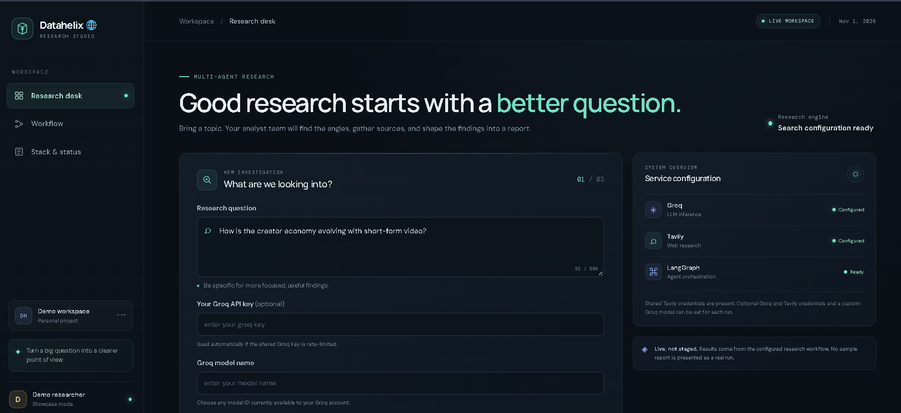

<div align="center">

# ***Datahelix 🌐***
---

### ***🤖 Multi-Agent Research Studio • Human-in-the-Loop • Live Web Research • Structured Reports***
***LangGraph Agent Orchestration • Groq LLM Inference • Tavily Web Search • Parallel Analyst Research • Human Review Before Research Starts***

<p align="center">

</p>

<p align="center">


</p>

---

### ***🌟 About Datahelix***

***Datahelix is a multi-agent research studio. You type a research question, and the system builds a team of AI analysts, each with a different perspective. You review the team, then the analysts research in parallel using live web search and their findings are combined into a single structured report.***

***It is a live workflow, not a demo. Results come from the configured research pipeline, and no sample report is presented as a real run.***

<p align="center">
<a href="https://datahelix.onrender.com/" target="_blank">

</a>
</p>
</div>

---

### ***🌐 Live Demo***

***Web Application 👉 [Datahelix](https://datahelix.onrender.com)***

---

### ***📸 Project Preview***

<p align="center">

</p>

---

### ***✅ What Datahelix Can Do***

- 🔎 Turn one research question into a focused investigation (up to 500 characters)
- 👥 Generate a team of analysts, each with a distinct perspective (choose team size)
- ✋ Human-in-the-loop: review the analyst team before research starts
- ⚡ Parallel research: analysts gather evidence at the same time
- 🌐 Live web research through Tavily
- 🧾 Final structured report that combines all findings
- 📊 Research activity tracker showing the current stage
- ⚙️ Service configuration panel showing Groq, Tavily and LangGraph status
- 💡 One-click starter prompts (AI in software teams, Urban food waste, Creator economy)
- 🌑 Modern dark-theme interface

---

### ***🧠 How It Works***

```text
                 💬 Research Question
                          │
                          ▼
              1. Find the Angles
        (generate a team of analyst personas)
                          │
                          ▼
              2. Review the Analysts
          (human approves / adjusts the team)
                          │
                          ▼
              3. Gather the Evidence
      ┌───────────┬───────────┬───────────┐
      ▼           ▼           ▼           ▼
  Analyst 1   Analyst 2   Analyst N    (parallel)
      │           │           │
      └─── Tavily web search + Groq LLM ──┘
                          │
                          ▼
              4. Shape the Report
        (combine insights into one report)
                          │
                          ▼
                  📄 Final Report
```

| Step | Stage | Purpose |
|---|---|---|
| 1 | **Find the angles** | Build a team of research perspectives from the question |
| 2 | **Review the analysts** | You decide when the research starts (human-in-the-loop) |
| 3 | **Gather the evidence** | Analysts search sources and build insights in parallel |
| 4 | **Shape the report** | Bring all findings together into a single report |

---

### ***💡 Example Questions***

- *How is the creator economy evolving with short-form video?*
- *How is AI changing the way software teams work?*
- *What are the main causes of urban food waste and how can cities reduce it?*

---

### ***🧩 Tech Stack***

### ***AI & Agents***

- **LangGraph** for agent orchestration (stateful graph, parallel branches, human-in-the-loop interrupt)
- **Groq** for fast LLM inference
- **Tavily** for live web research

### ***Application***

- **Python 3.11**
- **Backend API** (see `src/`)
- **Custom dark-theme frontend** (HTML, CSS, JavaScript)

### ***Deployment***

- **Docker**
- **Render**

---

### ***🧪 Why Human-in-the-Loop Matters***

Fully automatic research can drift in the wrong direction. Datahelix pauses after generating the analyst team so you can check the angles before any search budget is spent.

```text
Question → Analyst team generated
                ↓
        Human reviews the team
                ↓
   Approve → Parallel research → Report
   Adjust  → Regenerate analysts
```

---

### ***⚠️ Limitations***

- Report quality depends on the quality of web sources returned by search.
- LLM output can contain mistakes; always verify important claims against the sources.
- Free-tier hosting may have cold starts and non-persistent storage.
- Groq and Tavily require network access, valid API keys and are subject to rate limits.

---

### ***🔮 Future Enhancements***

- Export reports to PDF / Markdown
- Saved research history and user accounts
- Inline source citations with links in every report section
- Streaming progress for each analyst
- Support for uploading private documents as an extra source
- Evaluation suite for report quality

---

### ***🎯 Real-World Use Cases***

✔ Market and Trend Research

✔ Topic Exploration for Writers and Students

✔ Competitive Analysis

✔ Literature and Background Scans

✔ Multi-Agent Workflow Demonstration

✔ AI/ML Portfolio Project

---

## ***🧠 Key Learning Outcomes***

1. Design a stateful multi-agent workflow with LangGraph.
2. Run analyst agents in parallel and merge their results.
3. Add a human-in-the-loop approval step to an agent graph.
4. Integrate Tavily live web search with an LLM.
5. Use Groq for low-latency LLM inference.
6. Generate a structured report from multiple agent outputs.
7. Build a custom research-studio frontend.
8. Package the app with Docker and deploy it on Render.

---

## ***👨‍💻 Developer***

<div align="center">

## ***ANKIT GUPTA 👦***

### ***AI Engineer • AI Backend Developer • GenAI Developer***

**Building practical AI systems with Python, RAG and multi-agent workflows**

</div>

---

### ***⭐ Support the Project***

If you find Datahelix useful:

- ⭐ Star the repository
- 🍴 Fork the project
- 🐛 Report issues
- 💡 Suggest new features
- 📢 Share the project

---

<div align="center">

### ***Datahelix: From Question to Clarity 🌐***

***Ask Big Questions. Review the Team. Read the Report.***

### ***Built with ❤️ by Ankit***

</div>
